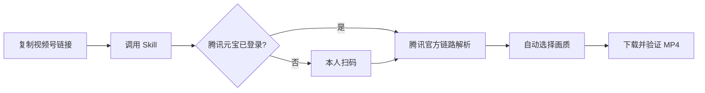

# 视频号下载 Skill

> 复制视频号分享链接，扫码一次，自动解析并下载到本地。

[](https://openai.com/codex/)
[](#系统要求)
[](#系统要求)
[](LICENSE)

很多视频号下载方案需要抓包、安装证书、修改系统代理，或者依赖随时可能失效的第三方解析网站。这个 Skill 走的是一条更简单的路径：

**把视频号“复制链接”交给 Codex → 首次使用扫码登录腾讯元宝 → 自动解析并下载 MP4。**

已经登录时，下一次只需要粘贴链接。

## 为什么值得安装

- **真的能下载**：已经用真实视频号链接完成端到端验证。
- **操作足够简单**：复制链接、扫码、等待下载完成。
- **不折腾系统环境**：不安装证书、不修改代理、不启动常驻服务。
- **不依赖公共解析站**：默认使用腾讯官方页面和官方接口链路。
- **自动选择画质**：优先可确认的原画，必要时回退到兼容格式。
- **Mac / Windows 通用**：核心脚本只使用 Python 标准库。
- **更安全**：不读取或导出 Cookie、密码、验证码和浏览器存储。
- **下载失败可重试**：权限审批或网络中断时，不必重新扫码。

## 30 秒安装

### 方法一：让 Codex 帮你安装

把下面这句话发给 Codex：

```text
请安装这个 Skill：
https://github.com/zhengzhentao86/download-wechat-channels/tree/main/download-wechat-channels
```

### 方法二：手动安装

1. [下载仓库 ZIP](https://github.com/zhengzhentao86/download-wechat-channels/archive/refs/heads/main.zip) 并解压。
2. 把其中的 `download-wechat-channels` 文件夹复制到：
   - macOS：`~/.codex/skills/`
   - Windows：`%USERPROFILE%\.codex\skills\`
3. 重新打开 Codex 或新建一个任务。

## 一句话使用

在微信视频号中点击“分享 → 复制链接”，然后发给 Codex：

```text
$download-wechat-channels https://weixin.qq.com/sph/你的分享ID
```

首次使用会显示腾讯元宝官方登录页。请本人扫码，Skill 检测到登录成功后会自动继续，无需再回复“已登录”。视频默认保存到：

- macOS：`~/Downloads/视频号`
- Windows：系统“下载/视频号”目录



## 支持的画质

| 模式 | 说明 |
| --- | --- |
| `auto` | 默认。优先原画，无法确认原画时自动选择兼容格式 |
| `original` | 必须下载可确认的原画，否则报错，不静默降级 |
| `compatible` | H.264，播放兼容性最好 |
| `h265` | 文件通常更小，但旧设备兼容性较差 |

例如：

```text
用 $download-wechat-channels 下载这个链接，选择 compatible 兼容画质：
https://weixin.qq.com/sph/你的分享ID
```

## 系统要求

- Codex Desktop，具备应用内浏览器能力
- macOS 或 Windows
- Python 3.9 或更高版本
- 可正常访问腾讯元宝和视频号相关官方域名
- 用户本人的腾讯元宝登录账号

不需要额外安装 Python 第三方包。

## 工作原理与隐私

1. Skill 校验 `weixin.qq.com/sph/` 分享链接。
2. 在 `yuanbao.tencent.com` 官方页面内检查用户登录状态。
3. 使用用户当前登录态调用腾讯官方解析链路。
4. 只把经过清洗的一次性播放信息写入权限受限的临时文件。
5. 从腾讯媒体域名下载视频并验证 MP4 完整性。
6. 下载成功后自动删除一次性解析文件。

Skill 不会读取、导出或打印 Cookie、Local Storage、密码、验证码、账号令牌或媒体 URL，也不会把链接发送给第三方公共解析器。

## 项目结构

```text
download-wechat-channels/
├── SKILL.md
├── agents/openai.yaml
├── scripts/
│   ├── channels.py
│   └── yuanbao_bridge.mjs
└── references/
    ├── resolver.md
    └── troubleshooting.md
```

## 关于作者

我是 **郑镇涛**，抖音电商认证讲师，专注 AI 在电商业务中的实战落地。

我长期研究并实践 AI 在短视频、直播、内容生产、运营复盘和团队提效中的应用。比起追逐概念，我更关心的是：怎样把 AI 变成电商老板和运营团队今天就能执行的流程、工具和结果。

这个 Skill 由【镇涛 AI 实战笔记】免费开源。

- 加微信 **7838053**，学习更多 AI 电商落地干货
- [AI 电商实战知识库](https://bvvp9yto7k.feishu.cn/wiki/ZIbrwShfkirvVok3hIHcUz5nnTc)

如果这个项目帮你省下了时间，欢迎点一个 Star，也欢迎把它分享给需要的朋友。

## 使用边界

本项目仅用于保存用户自有、已获授权或平台允许下载的内容。请尊重著作权、隐私权和平台规则，不要绕过付费、私密、删除或其他访问控制。本项目与腾讯、微信、视频号或腾讯元宝不存在官方隶属或合作关系。

## License

[MIT License](LICENSE)
